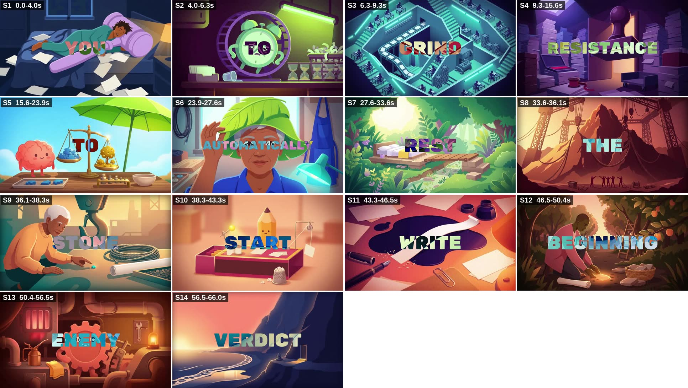

# 10. Teardown: "Your Brain Isn't the Enemy" (master prompt v4.1)

This is the first video made end to end with master prompt v4.1. It is measured the same way as
the course video in [`06-reference-video-teardown.md`](06-reference-video-teardown.md). File:
`your-brain-isnt-the-enemy-final-66s.mp4`.



**Short version:** the craft layer works. Cast rotation, the surprise in each scene, the colour
arc and the audio all meet the prompt. Most of what is wrong comes from timing and legibility
in the edit, and it can be fixed without regenerating a single clip. One problem is bigger:
the format. The video is 16:9, and every other doc in this repo commits to 9:16.

---

## Measured facts

| Property | Measured | Target | Result |
|---|---|---|---|
| Resolution | **1920 × 1080 (16:9)** | v4.1 says 16:9; docs/03 and your appeal (docs/05) say 1080 × 1920 | **Conflict** |
| Frame rate / codec | 30 fps, H.264, AAC 48 kHz stereo | 30 fps | Pass |
| Duration | 66.0 s | 62–72 s, and over 60 s for Creator Rewards | Pass |
| Words spoken | ~149 | 150–175 | Pass (just under) |
| Pace | ~137 wpm | ~145 wpm | Pass |
| Scenes | 14, all hard cuts | 90% hard cuts | Pass |
| Scene length | 2.2–9.5 s, last scene longest | 2.5–8 s (holds to ~12 s), final scene longest | Pass |
| Loudness | −16.2 LUFS integrated, −1.6 dBTP true peak, LRA 3.3 LU | about −16 LUFS, steady | Pass |
| Music bed | never drops below −50 dB | never silent | Pass |
| Text baked into generated images | none found | none | Pass |
| Word cards on screen for 3 frames or fewer (≤ 0.1 s) | **at least 12**, two of them for a **single frame** | typical hold 0.3–0.4 s | **Fail** |
| Cuts where the last word of the previous line sits over the new scene | **12 of 13** | 0 | **Fail** |

---

## Scene map

| # | Time | Len | Cast | Picture | Line(s) |
|---|---|---|---|---|---|
| 1 | 0:00.0 | 4.0 | person | Man asleep hugging a giant purple gavel, papers across the bed | Every time you want to rest, you call yourself lazy. |
| 2 | 0:04.0 | 2.3 | object w/ face | Alarm clock with arms running in a hamster wheel; hourglasses, green grow light | Force yourself to push through. |
| 3 | 0:06.3 | 3.1 | crowd | Aerial maze of cubicles around a conveyor belt, teal neon | Hustle harder. Grind longer. |
| 4 | 0:09.3 | 6.2 | object | Room walled with paper stacks under a giant rubber stamp | But here's a different way to understand that resistance. Start by dropping the accusation. |
| 5 | 0:15.6 | 8.3 | object w/ face | Smiling brain beside a scale: blue crystals vs a gold-coin tree, green parasol, blue sky | Research suggests you weigh mental effort against what you expect to gain. The effort matters. So does the reward. |
| 6 | 0:23.9 | 3.8 | person | Extreme close-up: older woman lifting a leaf hat, workshop | Wanting less effort doesn't automatically make you weak. |
| 7 | 0:27.6 | 5.9 | environment | Bed on a wooden deck in a sunlit jungle clearing | Sometimes you need real rest. Sometimes you need a smaller first step. |
| 8 | 0:33.6 | 2.5 | crowd | Silhouettes hauling a mountain with cranes | Don't try to lift the whole mountain. |
| 9 | 0:36.1 | 2.2 | person | Older man picking up one pebble under a crane hook | One stone you can move. |
| 10 | 0:38.3 | 5.0 | object w/ face | Pencil tucked into a matchbox bed, thimble, tiny lamp | Break it down. Make it tiny. Start so small it feels silly. |
| 11 | 0:43.3 | 3.2 | abstract | Top-down ink pool with a paper ribbon, fountain pen | Open the document. Write one rough sentence. |
| 12 | 0:46.5 | 3.9 | person | Man in an orchard setting down a glowing stone, basket of stones | Give yourself a clear beginning. Then choose the next step. |
| 13 | 0:50.4 | 6.1 | object w/ face | Gear with a face in a warm workshop, oil can, lantern | You can work hard without making yourself the enemy. Effort doesn't have to become punishment. |
| 14 | 0:56.5 | 9.5 | environment | Sunset cliff, waves, a stone cairn and a lit open doorway | Your brain isn't a character flaw. Every pause doesn't need a verdict. Stop fighting yourself. Give yourself a place to begin. |

---

## What already works: keep it

1. **Cast rotation is perfect.** Across 14 scenes, no two neighbours share a cast type.
2. **Every scene has its surprise:** a gavel used as a body pillow, a clock in a hamster wheel, a
   crane hook lowered over a pebble, a pencil asleep in a matchbox, a door in a cliff.
3. **Colour follows the arc.** The problem scenes (S1–S4) are navy, purple and sickly green. The
   first bright sky lands exactly on the reframe (S5). The turn is warm and the landing is a sunset.
4. **A motif you didn't plan: stones.** It runs mountain (S8) → one stone (S9) → basket of stones
   (S12) → a cairn on the cliff in the final shot (S14). Callbacks like this make a video feel
   authored. Next time, make it deliberate (see the patch).
5. **Audio meets the spec, and the ending breathes.** The final hold is 9.5 s, with about 0.4 s
   of clean picture after the last word.

---

## What to fix, ranked

### 1. The format works against your own plan, if this video is for TikTok

v4.1 locks 16:9. Docs 01–06 and your re-application text in docs/05 commit to **1080 × 1920, full
screen, no black bars**. In the TikTok feed, a 16:9 file plays as a band across the middle of the
phone, with empty space above and below. That is the "black screens" item from your rejection,
and it contradicts the sentence in your appeal.

Cropping this video won't fix it. A 9:16 slice of a 1920 × 1080 frame is 608 × 1080. It would
need a 1.8× upscale and would cut subjects in half (the brain in S5, the woman in S6). The scenes
have to be generated vertically. If this video is going to YouTube instead, ignore this item. If
it is going to TikTok, apply patch A below before you make the next video.

### 2. Cuts arrive before the words (editor fix, no regeneration)

At 12 of 13 cuts, the last word card of the old line stays over the new scene for 0.1–0.5 s:

| Cut | Leftover card over the new image | How long |
|---|---|---|
| 0:56.5 → landing | PUNISHMENT over the calm sunset | **0.5 s** |
| 0:46.5 → orchard | SENTENCE | 0.4 s |
| 0:50.4 → gear | STEP | 0.4 s |
| 0:36.1 → stone | MOUNTAIN | 0.3 s |
| 0:38.3 → pencil | MOVE | 0.3 s |
| 0:43.3 → ink | SILLY | 0.3 s |
| 0:33.6 → mountain | STEP | 0.25 s |
| others | THROUGH, LONGER, ACCUSATION, REWARD, WEAK | 0.1–0.15 s |

The worst one is PUNISHMENT: the first thing the viewer reads on the peaceful final image is the
heaviest word in the script. **Fix:** slide each cut later, so the new image and the first word of
its line arrive on the same frame.

### 3. Flash cards (editor fix)

At least 12 word cards are on screen for 3 frames or fewer: BUT, A, THE, SO, A, BREAK, MAKE,
WRITE, YOUR, STOP, and two that last **a single frame**:

- **THEN** at 0:49.07 ("Then choose the next step")
- **GIVE** at 1:04.00 ("Give yourself a place to begin"). This is the final line, and its first
  word cannot be seen.

These timings look like raw word timestamps from an aligner. **Fix:** no card shorter than 6
frames (0.2 s). When a word is spoken faster than that, put it on one card with the next word
(GIVE YOURSELF, A PLACE, THEN CHOOSE).

### 4. Difference-blend text disappears on mid-tones

White text in difference mode inverts the picture behind it. Over a mid-grey or skin tone, the
inverse is also mid-grey, so the word vanishes. Share of mid-tone pixels (luma 96–160) behind the
word card, by scene:

| Scene | Mid-tone behind the word | How it reads |
|---|---|---|
| S6 woman, face close-up | **72%** | "AUTOMATICALLY" across her eyes, nearly invisible |
| S13 gear | **59%** | two-tone, broken letters |
| S9 man with stone | **55%** | ONE / YOU / STONE / MOVE in faint lavender-grey |
| S1 man with gavel | 46% | busy |
| S11 ink pool | **5%** | crisp |
| S14 sunset cliff | 12% | crisp |

**Fix:** control the tone behind the word in the image prompt. Keep the middle band clearly dark
or clearly bright, and never put a face there. For any scene that still comes back mid-tone, the
editor falls back to solid text.

### 5. The worked example leaked into the video

The v4.1 worked example is "Make it embarrassingly small", with a blocky mountain, one block, a
clock with arms and a tiny silhouette. This video says "Start so small it feels silly" and "Don't
try to lift the whole mountain", then shows one stone, a mountain and a clock with arms. The model
copied the example instead of only learning its layout. Over 30 videos that becomes a template
look, which is on the auto-fail list in docs/03.

### 6. The script spends its time on the wrong phase

| Phase | v4.1 target | This video |
|---|---|---|
| Hook + problem | ≈ 25% | 0:00–0:15.6 → 24% |
| Reframe | **≈ 35%** | 0:15.6–0:27.6 → **18%** |
| Turn | **≈ 25%** | 0:27.6–0:56.5 → **44%** |
| Landing | last 1–3 lines | **4 lines**, 9.5 s |

The reframe sets up a two-sided scale: **effort vs reward**. The turn then works only one side.
Seven lines in a row say "make it smaller": smaller first step, one stone, break it down, make it
tiny, start so small, one rough sentence, clear beginning. The prompt's "no lists longer than 3"
rule didn't catch this, because each item is its own sentence. Nothing in the turn acts on
reward, so the video's own science is left half-used.

Smaller script notes:

- The title line, "your brain isn't the enemy", is never spoken. The closest lines are "your
  brain isn't a character flaw" and "making yourself the enemy".
- "Give yourself…" appears twice (0:46 and 1:04), which weakens the closing line.
- "Every pause doesn't need a verdict" literally means "*not every* pause needs one". "No pause
  needs a verdict" says what you mean.

The one fact claim is fine. "Research suggests you weigh mental effort against what you expect
to gain" matches the cost-benefit view of mental effort in cognitive science, and the hedge is
right.

### 7. Two long holds are nearly still

This is the average frame-to-frame change outside the text band. The median scene is about 0.22.

| Scene | Length | Motion | Note |
|---|---|---|---|
| S7 jungle bed | 5.9 s | **0.08** | close to a still, and it carries two different ideas (rest *and* first step) |
| S10 pencil in matchbox | 5.0 s | **0.09** | close to a still |
| S4 paper room + stamp | 6.2 s | 0.13 | the line says "**dropping** the accusation", but the stamp never moves |

"Slideshow of still images" is on the docs/03 auto-fail list. Each of these needed one visible
action that matches the line's verb, such as the stamp lifting away on "dropping".

### 8. Six warm scenes in a row

S8 through S13 (0:33–0:56) are all orange, peach, coral and rust. Neighbouring scenes stop
feeling different, and the sunset landing doesn't stand apart from them. The landing's payoff
objects, the cairn and the lit door, are also small and tucked into the bottom-right corner,
which is where TikTok's like and comment column sits in 9:16.

---

## Patch: v4.1 → v4.2

These are paste-in replacements and additions, keyed to your section letters.

### A. FORMAT (Prompt 3, Section A). Apply only if the video is for TikTok

```
- 9:16 vertical, 1080×1920, 30 fps, full bleed. Every image and every clip is generated 9:16
  natively. Never crop, letterbox or pillarbox a 16:9 frame.
- Safe zones: keep the word card, faces and the scene's payoff object out of the top 12%,
  bottom 20% and right 20% of the frame.
```

Also make these changes everywhere else in the prompt:

- In the IMAGE PROMPT template, change `16:9` to `9:16 vertical`.
- In IMAGE NEGATIVE, replace `vertical frame` with `horizontal frame, landscape orientation`.
  Otherwise the negative prompt fights the new format.
- Section E size: `cap height ≈ 120 px; any word wider than 60% of frame width shrinks to fit.`

### B. TEXT LEGIBILITY (Prompt 3, add to Section C2 as rule 11, and to Section E)

```
11. TEXT BAND: the middle third of every image (where the word card sits) must be clearly dark
    or clearly bright: deep shadow, night sky, bright sky, white wall. Never a face, skin,
    or mid-grey / beige surface there. State the text-band tone in every IMAGE PROMPT:
    "center of frame in [deep shadow / bright sky]".
```

```
- LEGIBILITY FALLBACK: if a scene's center is mid-tone anyway, that scene uses solid #FFFFFF
  with a soft 40% black shadow instead of difference blend.
```

### C. CARD TIMING (Prompt 3, Section E)

```
- MINIMUM HOLD: no card is on screen for fewer than 6 frames (0.2s). A word spoken faster
  than that shares one card with the word after it ("GIVE YOURSELF", "A PLACE").
```

### D. CUT TIMING (Prompt 3, Section F)

```
- The cut and the first word card of the new line land on the SAME frame. The previous line's
  last card never appears over the new scene. During a pause, the old scene holds; the cut
  waits for the next word.
```

### E. MOTION (Prompt 3, Section C2, extend rule 5)

```
   The primary action is the line's verb, shown literally ("dropping the accusation" → the
   stamp lifts away and out of frame). Any scene held 5s or longer needs a second visible beat
   at mid-hold, not only background loops.
```

Add to rule 10:

```
   One scene = one idea. If two consecutive lines carry different ideas, they get two scenes.
```

### F. COLOUR (Prompt 3, Section C2, extend rule 4)

```
   No more than 3 consecutive scenes in the same hue family. The LANDING uses a palette no
   other scene uses. The landing's payoff object is at least 15% of frame height and sits
   inside the safe zone.
```

### G. MOTIF (Prompt 3, Section B, add)

```
OPTIONAL PROP MOTIF: one small object that changes meaning across the video (a stone: the
mountain → one stone → a basket of stones → a finished cairn). List the scenes it appears in.
```

### H. ANTI-COPY (put above the WORKED EXAMPLE heading, and in Prompts 1 and 3)

```
The worked example shows FORMAT ONLY. Never reuse its hook, angle, wording, metaphors or props
(mountain, block, clock with arms, tiny silhouette under stars, "embarrassingly small") in a
new video. If an idea drifts toward them, pick a different visual world.
```

### I. SCRIPT BALANCE (Prompt 2, add under STRUCTURE)

```
6. MECHANISM RULE: if the REFRAME names a mechanism with more than one side (effort vs reward,
   threat vs safety), the TURN gives one concrete action for EACH side.
7. REPETITION LIMIT: no more than 3 consecutive lines may make the same point, even if each
   is its own sentence.
8. TITLE RULE: the video's title phrase is spoken once, in the HOOK or the LANDING.
9. LANDING: 1–3 lines, 20 words max, and it may not reuse a phrase used earlier in the script.
```

Add to the OUTPUT list:

```
7. PHASE BUDGET: seconds per phase at 145 wpm. If REFRAME < 30% or TURN > 30% of the total,
   rewrite before output.
```

---

## Reconstructed script (from the on-screen word cards)

```
HOOK      0:00  Every time you want to rest, you call yourself lazy.
PROBLEM   0:04  Force yourself to push through.
          0:06  Hustle harder. Grind longer.
PIVOT     0:09  But here's a different way to understand that resistance.
          0:13  Start by dropping the accusation.
REFRAME   0:16  Research suggests you weigh mental effort against what you expect to gain.
          0:21  The effort matters. So does the reward.
          0:24  Wanting less effort doesn't automatically make you weak.
TURN      0:28  Sometimes you need real rest. Sometimes you need a smaller first step.
          0:34  Don't try to lift the whole mountain. One stone you can move.
          0:38  Break it down. Make it tiny. Start so small it feels silly.
          0:43  Open the document. Write one rough sentence.
          0:47  Give yourself a clear beginning. Then choose the next step.
          0:50  You can work hard without making yourself the enemy.
          0:54  Effort doesn't have to become punishment.
LANDING   0:57  Your brain isn't a character flaw. Every pause doesn't need a verdict.
          1:02  Stop fighting yourself. Give yourself a place to begin.
```

→ Back to [README](../README.md)
