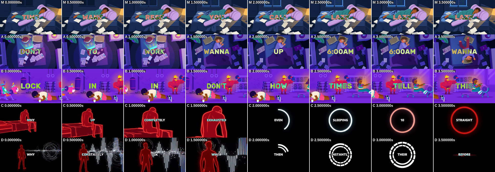

# 11. Why the references feel fast: a frame-by-frame measurement

Four reference videos (TikTok downloads) were measured against your first master-prompt
video:

| Code | Video | Size | Length |
|---|---|---|---|
| **M** | yours: *Your Brain Isn't the Enemy* (v4.1) | 1920 × 1080 | 66.0 s |
| **A** | @iddietothissong (…676407) | 1024 × 576 | 69.0 s |
| **B** | @iddietothissong (…771315) | 1024 × 576 | 69.0 s |
| **C** | @thecognitionswitch (…046086): "Why do you wake up exhausted…" | 1280 × 720 | 62.5 s |
| **D** | @thecognitionswitch (…164398): "Why do you constantly ask 'what?'…" | 1280 × 720 | 62.6 s |

**All four references are 16:9 horizontal on TikTok.** That corrects item 1 of
[`10-teardown-your-brain-isnt-the-enemy.md`](10-teardown-your-brain-isnt-the-enemy.md): the
channels you are modelling post 16:9. The remaining conflict is with your own appeal text in
docs/05, which promises 1080 × 1920. If you post 16:9, change that sentence.

*The first 4 seconds of each video, one frame every 0.5 s. Row M is the same picture eight
times. In A, the bedroom is re-posed three times and the character flips upside down. In B,
the whole gym is in motion. In C the camera pushes in until the figure doubles in size, then
a ring draws itself. In D the waveform animates and the camera pushes in, then a ring builds.*

---

## The numbers

| | M (yours) | A | B | C | D |
|---|---|---|---|---|---|
| **Words spoken** | 149 | 242 | 220 | ≈ 192 | ≈ 199 |
| **Speaking speed** | **135 wpm** | 210 | 191 | ≈ 186 | ≈ 193 |
| **Shots** | 14 | 19 | 19 | 29 | 33 |
| **Average shot** | **4.71 s** | 3.63 | 3.63 | 2.16 | 1.90 |
| Median shot | 3.93 s | 2.67 | 3.50 | 2.25 | 1.75 |
| Longest shot | 9.53 s | 8.27 | 8.25 | 2.75 | 3.00 |
| Shots longer than 5 s | **43%** | 21% | 11% | 0% | 0% |
| Shots 2.5 s or shorter | 21% | 42% | 32% | 90% | 85% |
| Spoken words per shot | 10.6 | 12.7 | 11.6 | 6.6 | 6.0 |
| First cut | 3.97 s | 1.33 | 4.25* | 2.00 | 2.00 |
| Final shot | **9.53 s** | 4.90 | 3.50 | 2.75 | 2.80 |
| **Frames where the camera is moving** | **7%** | 55% | 45% | 95% | 98% |
| Pan speed when moving (% of frame width per second) | 2.7 | 12.3 | 11.9 | 21.3 | 26.5 |
| Zoom speed when moving (% per second) | 3.2 | 6.4 | 3.7 | 39.5 | 42.0 |
| **Motion inside the frame** (median, px/frame) | **0.05** | 0.49 | 0.53 | 1.41 | 1.01 |
| **Cuts with an audio hit** (random moments) | **31% (37%)** | 67% (25%) | 72% (37%) | 83% (21%) | 64% (26%) |
| Median word-card hold | 0.37 s | 0.23 | 0.23 | — | — |
| Word cards held 0.8 s or longer | 23 | 7 | 10 | — | — |
| Text cap height (% of frame height) | ≈ 14% | 13.9% | 15.3% | 6.5% | 6.5% |
| Text treatment | white, difference | white, difference | white, difference | white, difference | white, difference |
| Mean colour saturation | 0.58 | 0.76 | 0.78 | 0.30 | 0.33 |
| Near-black pixels | 1% | 2% | 0% | 65% | 62% |
| Loudness | −16.2 LUFS | −16.3 | −13.9 | −25.1 | −25.4 |

\* B's first cut comes at 4.25 s, but four characters are already moving from frame 1 (push-ups,
flexing, lifting).

### How each number was measured

- **Shots:** M, A and B by frame-difference cut detection, outside the text band. The detector
  found all 13 of M's cuts exactly. C and D are black-background videos, where the detector
  under-counts, so every shot change in C and D was read **by eye** from contact sheets at
  4 frames per second. Black beats and one-frame flashes are not counted as shots.
- **Speaking speed:** M, A and B by counting word-card changes. On M this gives 148 cards
  against 149 spoken words. C and D have small text, so their scripts were rebuilt from OCR
  plus the 4 fps sheets and counted. A hand count of D's first 12.9 s (42 words, 195 wpm)
  agrees.
- **Camera movement:** optical flow (OpenCV feature tracking plus a similarity transform
  between consecutive frames, text band excluded). A frame counts as "moving" if zoom exceeds
  3% per second or pan exceeds 3% of frame width per second. In C and D, part of the "zoom" is
  rings and waves expanding, but by eye the camera also pushes in constantly (in C, the
  figure in shot 1 doubles in size in 1.9 s).
- **Motion inside the frame:** the 90th-percentile leftover motion after removing the camera
  move. This is how far things move inside the picture.
- **Audio hits:** a jump of 6 dB or more in short-term loudness within 80 ms of a cut, compared
  with 300 random moments in the same video. In the references, cuts are 2–4× more likely
  than a random moment to carry a hit. In yours they are not.
- **Text size:** the bright-row profile of a clean word card on a dark background.

---

## What makes them feel fast, in order of size

1. **They talk 38–56% faster:** 186–210 wpm against 135. Your script told the voice to read at
   145 wpm, add a 0.5 s breath at every blank row and slow down before the turn. In the
   references the median word card lasts 0.23 s, and fewer than 10 cards last 0.8 s or longer
   (you had 23).
2. **Something is always moving.** Your camera moved in 7% of frames; theirs moves in 45–98%.
   Motion inside the frame is 10–28× yours. v4.1 asked for exactly what you got: "locked static
   camera", "one action completed in about 1 second, then a calm hold", and a motion negative
   that banned camera movement, zoom, pan, fast motion, sudden bursts and explosions. Those
   things are what B, C and D are made of: a desk smashed with a white flash, lightning,
   warp-speed tunnels, a map that erupts.
3. **Shorter shots, and none of them sit.** 43% of your shots run longer than 5 s. In the
   references it's 0–21%, and the @thecognitionswitch videos never hold a shot longer than 3 s.
   Your last shot was the longest at 9.5 s, because v4.1 rule 7 said "the FINAL scene holds the
   longest". The references end 2.8–4.9 s into their last shot.
4. **Cuts land on sound.** 64–83% of their cuts carry an audio hit (a word onset or a whoosh or
   impact). Yours land no more often than chance.
5. **Colour (cartoon style only).** A and B are far more saturated (0.76–0.78 vs your 0.58).

What is **not** the difference: format (16:9), text size for the cartoon style, the
difference-blend text, and loudness. You already match those.

---

## Two different "fast" styles

**@iddietothissong (A, B): "Cartoon Rush"**

- About 12 words per shot, the same as yours. The speed comes from the **voice (190–210 wpm)**
  and **constant motion**, not from cutting more often.
- Jump-cut sets: A opens with four shots of one bedroom from above in 6.8 s, each with a new
  pose (lying, upside down, rotated).
- Characters act through the whole shot: push-ups, a desk smashed to pieces, a girl flying
  through an orange swirl, a caveman fight, a chick driving through speed lines.
- 1–2 white flash frames per video (B at 4.75 s and 56.8 s) on the hardest-hitting word.
- The same egg-and-bird shot appears in both A (16.9–18.6 s) and B (45.0–47.0 s). This
  channel reuses its own clips.

**@thecognitionswitch (C, D): "Neon HUD"**

- About 6 words per shot: **the picture changes on every phrase**, roughly every 2 s.
- Black background, glowing red/cyan/white line art, one literal icon per key noun: a ring
  loader for "hours", a battery for "recharge", a gauge for "maximum capacity", an ECG line
  for "physical health", a chip for "processes".
- Constant push-ins and fly-throughs, plus elements that animate the whole shot (rings draw
  themselves, waveforms oscillate, gauge needles rise).
- Black beats: D at 13.0 s ("BUT"), 43.25 s and 58.0 s. A white starburst on the reveal word
  (D, 14.75 s).
- Both scripts follow the same structure:

| Phase | C | D |
|---|---|---|
| Hook question ("Why do you…?") | 0.0–4.1 s | 0.0–5.4 s |
| Physical symptoms | 4.3–9.1 s | 5.5–15.9 s |
| Wrong belief ("You think you have…") | 9.3–12.6 s | 16.0–19.6 s |
| Authority pivot ("…discovered") | 12.8–17.6 s | 19.8–24.1 s |
| Mechanism in technical terms | 17.8–48.1 s (**49%**) | 24.3–50.1 s (**41%**) |
| Payoff | 48.3–54.6 s | 50.3–54.9 s |
| Identity-flip landing | 54.8–62.5 s | 55.0–62.5 s |

  Both landings flip the "flaw" into a hidden strength and pay off the running metaphor: "Your
  supercomputer literally ran an ultra marathon while your eyes were closed." / "Your voice
  was just buffering while your supercomputer finished decompressing their words."

**What not to copy:** C credits a finding to "researchers at Stanford University", and D uses
claims like "biological marker of a high-speed brain". Your fact-check rules would reject both
as unverifiable, and they should keep doing so. Copy the structure, not the claims. And the
brain-as-supercomputer metaphor is their signature, so v5 forbids it.

---

## What changed in the master prompt

The full v5 prompt is at [`prompts/master-prompt-v5.md`](../prompts/master-prompt-v5.md).

| v4.1 rule | Measured | v5 rule |
|---|---|---|
| 150–175 words at ~145 wpm; blank row = 0.5 s breath | 186–210 wpm, median card 0.23 s | 195–215 words at 185–200 wpm; only two ⏸ beats |
| Scene length 2.5–8 s, holds up to ~12 s | average 1.9–3.6 s; 0–21% over 5 s | shot count = words ÷ 11 (Cartoon) or ÷ 6 (HUD) |
| Locked static camera; slow 1–2%/s push only | camera moving in 45–98% of frames | every shot has a named camera move with a speed |
| One action in ~1 s, then calm hold | motion 10–28× higher | the action lasts the whole clip; nothing frozen > 0.5 s |
| Motion negative bans zoom, pan, fast motion, bursts, explosions | all used constantly | negative now bans *static camera, frozen frame, slow motion* |
| Final scene holds the longest | last shot 2.8–4.9 s | final shot 3–5 s, end ≤ 0.5 s after the last word |
| SFX "subtle", impact only on key words | audio hit on 64–83% of cuts | audio hit on ≥ 70% of cuts |
| One style, palette flexible | two distinct measured styles | two presets with hard numbers |

Kept from v4.1/v4.2: 16:9, word-by-word difference-blend cards, fact-check rules, one surprise
per shot, specific props, light source, colour arc, cast rotation, text-band tone, minimum card
hold, cut-on-word, and the anti-copy rule.

→ Back to [README](../README.md)
