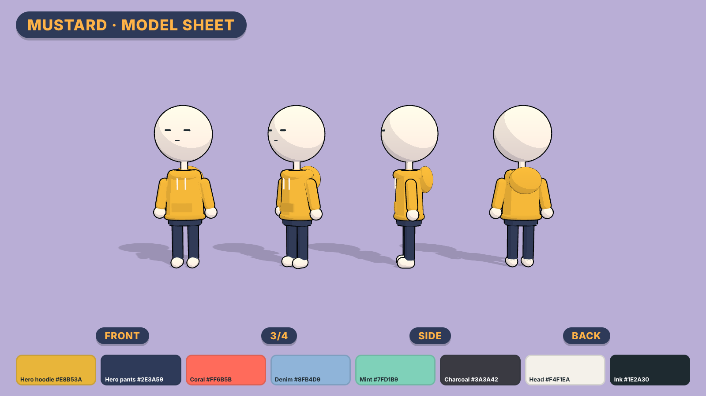
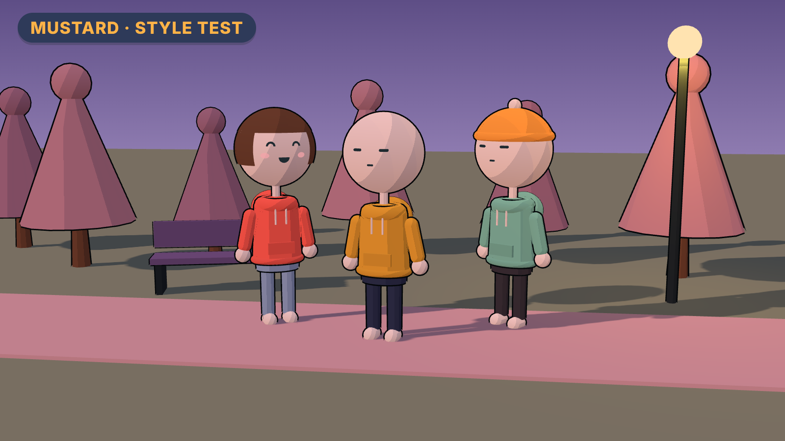

# Style guide

**Rule: same 3D look as the reference channel. Only the clothes change color.**





These two images are rough 3D renders that lock in the design and colors. They aren't meant to
show final quality. Upload `img/model-sheet.png` to your image generator as the character
reference. To try different colors, see [`render/README.md`](render/README.md).

## What stays the same as the reference

- **Characters:** a big white ball head on a thin white stick neck. The face is drawn in
  simple black lines: dash eyes for neutral, curved closed eyes with pink blush for happy,
  half-closed eyes for smug. Thin white arms, white ball hands, rounded white shoes.
- **Clothes:** a chunky hoodie with a hood, a front pocket and white drawstrings.
- **Rendering:** toon/cel shading with thin dark outlines.
- **Sets:** simple low-poly shapes, like rounded cone trees, blocky lockers and beds.
- **Lighting:** dusky purple and pink, warm glowing lamps and string lights, soft bokeh.
- **Camera:** like a film, with high wide shots, big face close-ups and low angles.

## What changes: the clothes

### The hero, "Mustard"

The viewer's stand-in, in every video:

| Item | Color | Hex |
|---|---|---|
| Hoodie | Mustard yellow | `#E8B53A` |
| Pants | Dark navy | `#2E3A59` |
| Shoes | White | `#F4F1EA` |

The reference hero wears a blue hoodie with bare white legs. Ours has a **mustard hoodie and
navy pants**, so Mustard is recognizable in a crowd shot and on every thumbnail. No other
character ever wears this combination.

### The supporting cast

The same body as the hero, with their own outfit colors plus hair or hats. Some combinations to use:

| Hoodie | Pants |
|---|---|
| Coral `#FF6B5B` | Light denim `#8FB4D9` |
| Mint `#7FD1B9` | Charcoal `#3A3A42` |
| Lilac `#B9A3E3` | Khaki `#CDB48A` |
| Sky blue `#7EC4F0` | Black `#1E2A30` |
| Cherry red `#D94A4A` | Grey `#9AA0A6` |

Give each recurring character (mom, best friend, rival) one fixed outfit and keep it in
every video, just like the hero.

## On-screen labels and captions

- **Labels** for game terms ("x64", "INVENTORY FULL"): a navy pill `#2E3A59` with mustard
  `#E8B53A` bold text, placed in a top corner. The hero's colors carry over into the graphics.
- **Captions:** white text with a dark outline in the lower third, a few words at a time.
- **Font:** [Fredoka](https://fonts.google.com/specimen/Fredoka) Bold. It's free and rounded.

## Thumbnails

Mustard's face big in the frame with a strong expression, the mustard hoodie clearly visible,
the one rule graphic as a navy and mustard label, and three words at most.

## Prompt building blocks

Every scene prompt is **CHARACTER + scene + LIGHTING + STYLE**. These blocks are already
filled in for Script 01 in [`prompts/01-inventory-in-real-life-visuals.txt`](prompts/01-inventory-in-real-life-visuals.txt).

**CHARACTER (Mustard)**
```
3D stick-figure character: large perfectly round smooth white sphere head, simple black hand-drawn face with small line eyes and a tiny mouth, thin white cylinder neck, round white ball hands, wearing a chunky mustard-yellow hoodie with a front pocket and white drawstrings, dark navy pants, small rounded white shoes
```

**LIGHTING** (pick the one for that part of the script)
```
Day:     soft lavender daylight with pink highlights
Evening: dusky purple and pink evening light
Night:   dark purple night lit by warm glowing lamps
```

**STYLE**
```
stylized low-poly 3D animation, cel-shaded with thin dark outlines, simple rounded set pieces, soft pastel colors, warm glowing practical lights, gentle bokeh, shallow depth of field, cinematic camera angle, no text --ar 16:9
```

**Lock the character first.** Upload `img/model-sheet.png` as the character reference and
generate REF-A to REF-C from the bottom of the prompt pack. Pick the best image, save it as
`hero-reference.png`, and use that same image as the reference for every scene in every video.
