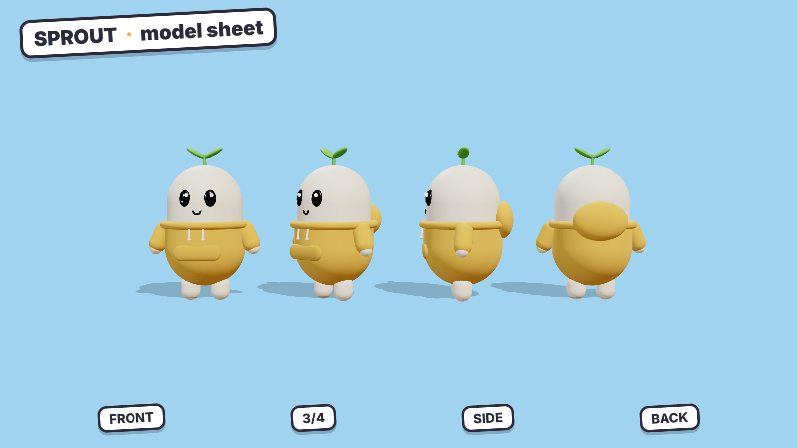
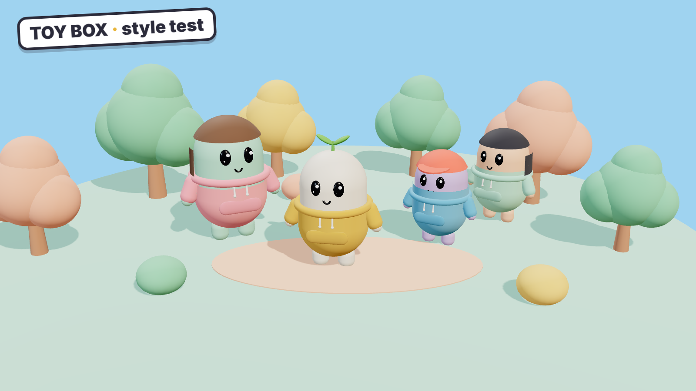

# Style guide: "Toy Box"

The channel's own look. It belongs to the same genre as the reference channel (cute 3D,
one simple hero, film-style camera work), but every visible choice is different, so a viewer
scrolling past knows within a second whose video it is.





These two images are rough 3D renders of the design. They're there to lock in Sprout's shape
and colors, not to show final quality. You can upload the model sheet straight to your image
generator as the character reference. To re-render them after a change, see
[`render/README.md`](render/README.md).

## Reference vs ours

| | Reference channel | **Ours: Toy Box** |
|---|---|---|
| **Character shape** | White ball head on a thin stick neck and stick limbs | **One-piece bean body**: no neck, head and body are one soft capsule, with short stubby arms and legs |
| **Face** | Drawn black lines: dash eyes, tiny mouth | **Big glossy oval eyes** with white highlights, small simple mouth, printed on like a toy |
| **Material** | Toon-shaded with thin black outlines | **Soft matte vinyl and clay**, rounded edges, **no outlines** |
| **World** | Low-poly blocky sets | **Miniature diorama**: tabletop-model sets with puffball trees and tilt-shift blur |
| **Palette** | Dusky purple and pink | **Sherbet daylight**: mint, peach, butter yellow, sky blue. Night is deep teal, never purple. |
| **Crowd** | Everyone is white | **Everyone else has a pastel body color**, so cream-colored Sprout always stands out |
| **On-screen labels** | Gold serif text on a dark pill | **Sticker labels**: white rounded stickers with a thick ink border, slightly tilted, that pop in with a bounce |

## The hero: Sprout

- **Body:** soft cream bean, about 1.6 times as tall as it is wide. Sprout is the only cream
  character in the whole world.
- **Eyes:** two big glossy black ovals in the upper third of the body, with one white highlight each.
- **Mouth:** a small simple curve. Expressions come from the eyes and mouth only: no eyebrows,
  no nose.
- **Signature 1:** a **two-leaf green sprout** on top. It droops when Sprout is sad and perks up
  when Sprout is excited, which gives you a free emotion cue in every shot.
- **Signature 2:** an **oversized mustard-yellow hoodie**, sleeves too long, with a front pocket.
- **Arms and legs:** short rounded nubs with no fingers. Sprout holds things like a toy would.

**Supporting cast:** the same bean body in mint, peach, lilac or sky blue. Tell them apart
by hair tufts, hats, glasses and clothes. Parents are taller beans; little siblings are
shorter and rounder.

## Palette

| Use | Color | Hex |
|---|---|---|
| Sprout's body | Cream | `#F6EFE3` |
| Signature hoodie | Mustard | `#E8B53A` |
| Sprout's leaves | Leaf green | `#6CC24A` |
| Daytime sky and backgrounds | Sky blue | `#9FD3F0` |
| Cast and sets | Mint | `#A8E6CF` |
| Cast and sets | Peach | `#FFC8A8` |
| Cast and sets | Lilac | `#CDB8F0` |
| Cast and sets | Butter | `#FFE8A3` |
| Night and tension | Deep teal | `#1E4E5F` |
| Warnings and danger labels | Coral | `#FF6B5B` |
| Text outlines and sticker borders | Ink | `#2B2B3A` |

### The color arc

The palette follows the structure of the script, so viewers can *feel* the turn before the
narrator says it:

- **Hook, rules, fun part:** full sherbet daylight, bright and saturated.
- **The cost:** the same sets get cooler and slightly desaturated, with teal creeping into the
  shadows.
- **The choice:** deep teal night, lit only by warm gold lamps and the glowing UI.

## Graphics and captions

- **Font:** [Fredoka](https://fonts.google.com/specimen/Fredoka), Bold or SemiBold. It's free,
  rounded and matches the toy look. Use it for every label, caption and thumbnail.
- **Captions:** white text with a thick ink outline, 2–5 words at a time, centered in the lower third.
  Color the key word mustard. Warning words like "FULL" or "DANGER" go in coral.
- **Sticker labels** for game terms ("+1 PENCIL", "x64", "INVENTORY FULL"): a white rounded
  rectangle with a 6 px ink border, tilted about −3°, with a soft drop shadow. They pop in
  with a quick overshoot bounce and a "pop" sound.
- **Game UI** (hotbars, grids, health bars): the same sticker treatment, white rounded slots
  with ink borders, so it looks like part of the toy world instead of a real game's menu.

## Camera

- **Wide shots** use strong tilt-shift, so the world looks like a tabletop model.
- **Close-ups** sit at Sprout's eye level, with the background melting into soft bokeh.
- **One "toy moment" per video:** the camera pulls back to show the whole scene is a diorama
  on a table. Save it for the biggest beat. In Script 01 that's the cafeteria explosion.

## Thumbnails

Sprout's face fills about 40% of the frame with a huge expression and the sprout reacting.
Add the one rule graphic as a sticker, three words at most in Fredoka with an ink outline,
and a single bright background color from the palette. Use a different background color
for each video so the channel page looks like a row of candy.

## Prompt building blocks

Every scene prompt is **CHARACTER + scene + PALETTE + STYLE**. These blocks are already
filled in for Script 01 in [`prompts/01-inventory-in-real-life-visuals.txt`](prompts/01-inventory-in-real-life-visuals.txt).

**CHARACTER**
```
cute 3D vinyl-toy character: a soft cream-colored bean-shaped body with no neck (head and body are one rounded capsule), short stubby arms and legs, big glossy black oval eyes with white highlights and a small simple mouth printed on the front, a small two-leaf green sprout growing from the top, wearing an oversized mustard-yellow hoodie with long sleeves
```

**PALETTE** (pick the one for that part of the script)
```
Day:     bright sherbet pastel palette of mint, peach, butter yellow and sky blue
Turning: cooler slightly desaturated pastel palette with teal shadows
Night:   deep teal night palette with warm gold lamp light
```

**STYLE**
```
miniature diorama world, soft matte vinyl and clay toy materials, rounded chunky shapes, tilt-shift depth of field, soft diffused light with gentle contact shadows, high quality 3D render, no text --ar 16:9 --no outlines, stick figure, neck, purple
```

`--no` keeps the generator away from the reference channel's look. In generators without
`--no`, put those words in the negative-prompt box.

**Lock the character first.** Upload [`img/sprout-model-sheet.png`](img/sprout-model-sheet.png)
as the character reference, then generate 4–8 images of Sprout alone on a plain sky-blue
background (prompts REF-A to REF-C at the bottom of the prompt pack). Pick the best one, save it
as `sprout-reference.png`, and use that same image as the reference for every scene in every
video. The character only stays consistent if you always use the same reference image.
